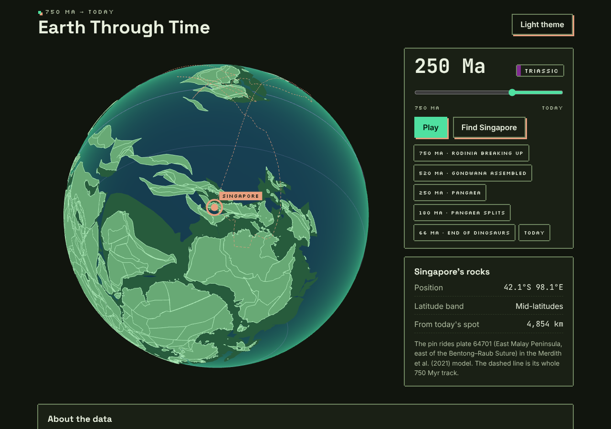
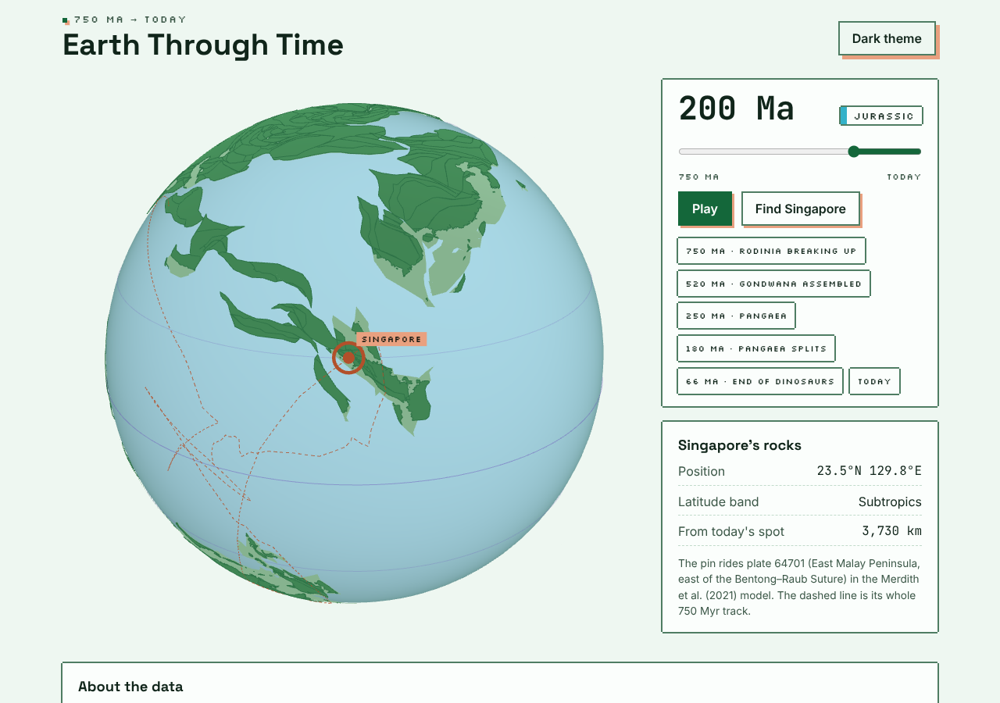
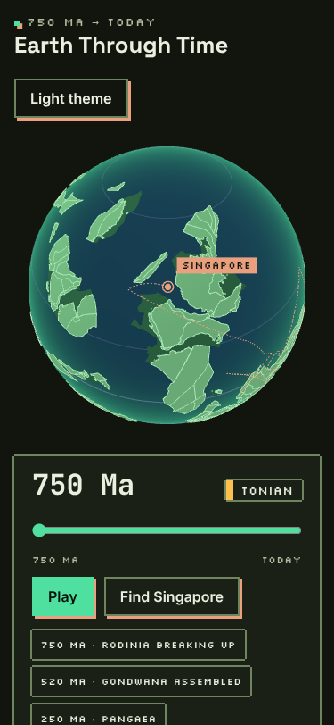

# Earth Through Time

A 3D globe that rewinds the continents **750 million years**. Watch Rodinia break up, Gondwana and then Pangaea assemble, and Pangaea split into today's continents. Scrub to any moment and follow a pin on **Singapore** to see where its rocks sat on the planet at that time.

The motion is a **real plate-tectonic reconstruction**, not an artist's animation. Every piece of continental crust is moved by its plate's rotation from the published Merdith et al. (2021) full-plate model by the EarthByte Group, computed with pyGPlates.



| Light theme, 200 Ma | Phone, 750 Ma |
|---|---|
|  |  |

## Using it
- **Drag** to turn the globe, **scroll or pinch** to zoom.
- Move the **time slider** (left is 750 Ma, right is today), press **Play**, or jump with the chips (Rodinia, Gondwana, Pangaea, today).
- **Find Singapore** turns the globe to the pin. The panel shows its palaeo-position, latitude band and distance from where it is today. The dashed line is its whole 750 Myr track.
- Share a moment: the address updates to `?ma=250` and opens there.
- Dark theme by default; light theme from the button. Respects *reduce motion*.

**What you see:** darker green is continental crust; lighter green is today's land shapes carried back in time; lavender lines are the equator, tropics and polar circles. The model uses a palaeomagnetic reference frame, so ancient latitudes are better constrained than longitudes, and everything before about 400 Ma carries more uncertainty.

## Run it locally
Needs Node 24 (`.nvmrc`) and npm.

```bash
npm ci --ignore-scripts
npm run dev                    # http://localhost:5173
npm run typecheck && npm run lint && npm test && npm run build   # build -> dist/
npm run test:e2e               # Playwright + axe, desktop and 375px (first run: npx playwright install chromium)
```

### Rebuilding the plate data (optional)
The reconstruction files in `public/frames/` are generated offline by `pipeline/build_frames.py` (Python, pyGPlates) and committed, so the site build needs no Python. See [`pipeline/README.md`](pipeline/README.md).

## Hosting
Static site for Cloudflare Pages: build command `npm run build`, output directory `dist`. `public/_headers` sets a strict Content Security Policy.

## Secrets and network calls
- **Secrets:** none.
- **Network calls:** only to its own origin (the page, scripts, fonts and the `frames/` data files, about 5 MB). No analytics, no cookies, no third-party hosts. The CSP allows `'self'` only. The only thing stored is your theme choice, in `localStorage`.

## Credits and citations
**Plate model (data, CC BY 4.0).** Merdith, A.S., Williams, S.E., Collins, A.S., Tetley, M.G., Mulder, J.A., Blades, M.L., Young, A., Armistead, S.E., Cannon, J., Zahirovic, S., Müller, R.D. (2021). Extending full-plate tectonic models into deep time: Linking the Neoproterozoic and the Phanerozoic. *Earth-Science Reviews* 214, 103477. <https://doi.org/10.1016/j.earscirev.2020.103477>. Model files v1.2.4 from the EarthByte Group: <https://www.earthbyte.org/webdav/ftp/Data_Collections/Merdith_etal_2021_ESR/> (also Zenodo, <https://doi.org/10.5281/zenodo.13635864>). Changes made here: polygons simplified (~16 km), triangulated, and rotations sampled every 1 Myr; see `pipeline/`.

The model compiles and builds on, and its readme asks users to cite: Domeier (2016, 2018); Merdith et al. (2017), *Gondwana Research* 50, 84–134; Young et al. (2019), *Geoscience Frontiers* 10(3), 989–1013; Matthews et al. (2016), *Global and Planetary Change* 146, 226–250; Tetley (2018), PhD thesis; Torsvik et al. (2019), *G-Cubed* 20(7), 3659–3689.

**Software.** [pyGPlates](https://www.gplates.org/) (University of Sydney / EarthByte) was used offline to compute the reconstructions; it is not shipped. [three.js](https://threejs.org/) (MIT) draws the globe. Geologic period ages and colours follow the [ICS International Chronostratigraphic Chart](https://stratigraphy.org/chart) (v2024/12).

**Fonts.** Space Grotesk, Inter, Silkscreen, JetBrains Mono (SIL OFL 1.1), self-hosted.

Full list: [`THIRD_PARTY_NOTICES.md`](THIRD_PARTY_NOTICES.md).

**Not affiliated** with or endorsed by the EarthByte Group, the University of Sydney, GPlates, or the authors of the model. Any errors in how the data is shown are this project's.

## Licence
Code: MIT (`LICENSE`). Plate-model data: CC BY 4.0, by its authors (above). Credits-card art: all rights reserved (`NOTICE.md`).

Provided as is, no warranty.
